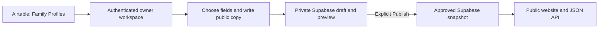

# Public website and owner workspace

| Component             | Responsibility                                                                                                              |
| --------------------- | --------------------------------------------------------------------------------------------------------------------------- |
| `apps/admin`          | Supabase owner sign-in, Airtable profile review, visibility choices, private draft saves, public preview, publish/unpublish |
| `apps/web`            | Public archive and read-only API; approved snapshots in published mode                                                      |
| `packages/content`    | Public content schema and formatting                                                                                        |
| `packages/publishing` | Public projection, draft/publication contracts, Supabase and fictional local stores                                         |
| Airtable              | Source working records; not modified by the dashboard                                                                       |
| Supabase              | Owner membership, private drafts, approved snapshots, private publication history                                           |

## Publication boundary

The owner signs in with email/password. Both server pages and API endpoints verify the Supabase user and its `aster_admin_members` entry. The publishable key is sufficient; no service-role secret is used. Database policies deny anonymous/private-draft access and deny non-owner mutations. Public readers can select only approved publication rows.

The dashboard requests an explicit field list from Family Profiles: name, summary, dates, agency, incident location, status, photo count, and relationship counts. Family contacts, email addresses, phone numbers, raw document contents, and attachment URLs are excluded. Source data is not stored in repository fixtures.

The owner writes a public introduction and selects structured fields, sections, and milestones. A shared projection removes unchecked values and source references before producing the public payload. Hidden facts are removed from the snapshot, not merely hidden with CSS. Review any dates or other information mentioned in authored narrative text separately; this is not automatic text redaction.

Saving a draft does not change the public website. Publishing atomically copies that saved snapshot and records its actor/version in private history. Later Airtable edits do not change it. Source fingerprints reject stale draft saves; database revisions reject concurrent stale edits. A changed source can be reviewed in a new draft without replacing the current public version. Unpublishing removes the publication row and keeps the draft/history.

The public app uses anonymous read access to `aster_publications`, with uncached server requests. Removing a publication also removes its public detail/API availability on refresh. It never falls back to live source data or fictional fixtures on a database failure.

## Development and following work

A loopback-only development demonstration uses fictional fixtures and an ignored local file. Its writer refuses real-person snapshots, and demo auth bypass is disabled in production. Browser tests run this isolated mode and do not modify Airtable or the live Supabase project.

Photo/document publication needs durable approved media storage and review controls. Source linking/editing, invitations/password recovery UI, an audit-history viewer, broader accessibility review, and hosted deployment remain following work. See [admin setup](admin-setup.md) for SQL, environment settings, running, and deployment.
