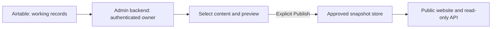

# Public website and owner dashboard

## Responsibilities

| Location           | Responsibility                                                                  | Status                                |
| ------------------ | ------------------------------------------------------------------------------- | ------------------------------------- |
| `apps/web`         | Public archive, profiles, timelines, read-only public API                       | Working with fictional fixtures       |
| `apps/admin`       | Owner login, private case review, display selection, preview, publish/unpublish | Placeholder only                      |
| `packages/content` | Public output validation/types, display helpers, public repository contract     | Shared workspace package              |
| Airtable           | Evolving internal cases, families, agencies, requests, logs, and media          | Not connected                         |
| Publication store  | Approved public snapshots and publication metadata                              | Not implemented; storage to be chosen |

The current mock repository stands in for the snapshot store. No admin workflow or approval enforcement has been implemented yet. Public sample records are already shaped as display-ready content, not raw Airtable rows.

## Publishing behavior to implement

1. The owner opens a case and sees available Airtable content, including incomplete data.
2. They choose public fields, sections, milestones, media, and ordering, and optionally edit the public-facing copy.
3. Private draft settings save without changing the public site. An authenticated preview uses those settings.
4. **Publish** validates and stores an approved copy of the selected content, plus its source case ID, version, publication time, and publishing owner.
5. The public website and JSON endpoints read only the currently published snapshot. They never resolve selected IDs against unapproved live Airtable values at request time.
6. Later Airtable edits remain drafts until another explicit publish. **Unpublish** removes public availability and invalidates any cached version, including direct case/API links.

Saving selection IDs alone is insufficient: if the selected Airtable text changes, visitors would see an unreviewed update. Store the approved values as a versioned snapshot. Make the active-version change atomic so a failed publish leaves the previous complete version intact. Missing/incomplete sections can stay empty; do not generate facts to fill them.

## Setup needed next

- **Airtable:** access to a test base, stable case/record IDs, exact table/field names, linked-record mappings, and fictional test records. Start from 180 Consulting's structure. Public narrative text and actual timeline events must have explicit source fields; staff calls/emails are not automatically public milestones.
- **Owner access:** choose a login provider and approved owner account(s). Enforce authorization server-side for private reads, preview, draft saves, publish, and unpublish. A separate admin URL alone does not protect data.
- **Publication storage:** choose where owner selections, drafts, approved snapshots, versions, and a publish audit trail live. A dedicated Airtable publication table or a separate application database are options to evaluate; keep the public read interface stable either way.
- **Credentials:** configure Airtable access only in the admin/backend environment with the permissions it needs. Give the public backend read-only access to published output, not private case-management records. No secrets use `NEXT_PUBLIC_` or enter Git.
- **Media:** decide where approved public photos/files are hosted and how rights/captions are recorded. A snapshot needs durable media references rather than permanently saved expiring Airtable attachment URLs. Restricted or removed media must stop being served.
- **Hosting/cache:** deploy the two apps independently from this repository. Configure the domains, per-app environment variables, a publication refresh/invalidation mechanism, and authenticated preview behavior. Ensure a publication reaches the homepage, case route, and JSON API together.

Use fictional records until these choices and the review process are agreed. Live mode should fail closed if its publication store is unavailable; do not fall back to demo records or expose raw Airtable data.

## Development boundaries

`@aster/content/schema` defines the **public output**. It is deliberately different from the future raw Airtable and owner-selection schemas. Keep those private contracts/adapters in the admin server initially; extract a separate shared server package only when both apps need it.

The `color` and other presentation fields in existing fixtures are UI concerns, not requirements imposed on 180 Consulting's base. The current `/api/cases` routes remain public and read-only. Any future admin routes must belong to the authenticated app and must not reuse the public endpoints for private data.

The current public renderer still offers five fixed story categories. When implementing owner selections, extend the public contract and renderer to distinguish an intentionally hidden section from a visible section with missing information, and honor the selected order. Hidden content must be excluded from the public payload, not merely hidden with CSS.
